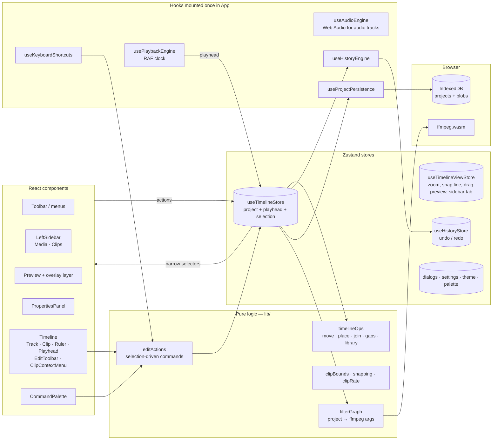

# Architecture

A browser-only non-linear video editor (NLE). There is no backend: media stays on the user's machine, projects persist to IndexedDB, and export runs FFmpeg compiled to WebAssembly in the tab.

This doc covers how the pieces fit, what each feature does, and where a feature's behavior comes from in an established editor. The project's reference editor is **Camtasia**, but behavior is not required to match it. Where a feature follows another editor, or none, the [Feature lineage](#feature-lineage) table says so.

For end-user instructions, see [EDITING_GUIDE.md](EDITING_GUIDE.md); for what changed when, see [CHANGELOG.md](CHANGELOG.md).

---

## 1. Repository layout

```
video-editor-web/                 pnpm + Turborepo monorepo
├── apps/web/                     the editor (Vite + React 19 SPA)
├── apps/marketing/               landing page (Next.js 15, static)
└── docs/                         this file, EDITING_GUIDE.md
```

| App | Stack | Dev URL | Talks to |
|---|---|---|---|
| `apps/web` | Vite 6, React 19, Zustand 5, Tailwind 4, Radix UI, `@ffmpeg/ffmpeg` 0.12, `idb-keyval`, `fflate` | `:5173` | `VITE_MARKETING_URL` (Home link; hidden when unset) |
| `apps/marketing` | Next.js 15, Tailwind 4 | `:3000` | `NEXT_PUBLIC_EDITOR_URL` ("Open Editor") |

Commands (from the repo root): `pnpm dev`, `pnpm build`, `pnpm typecheck`. Tests: `pnpm --filter @video-editor-web/web test` (Vitest).

The dev and preview servers send COOP/COEP headers so the page is cross-origin isolated. Both FFmpeg cores are self-hosted from `node_modules` by a small Vite plugin (`apps/web/vite.config.ts`), with no CDN involved.

Three settings are required to make export work at all:
- **ESM core builds.** `@ffmpeg/ffmpeg`'s worker is an ES module and can only `import()` the ESM core, not the UMD one.
- **Exclude from pre-bundling.** `@ffmpeg/ffmpeg` and `@ffmpeg/util` are excluded from Vite's `optimizeDeps`; otherwise the worker file isn't found and dev serves `index.html` in its place.
- **Single-threaded core by default.** `@ffmpeg/core-mt` 0.12's `load()` never settles under the module worker. The multi-threaded core stays available through `useFFmpeg({ multiThread: true })`.

---

## 2. Editor architecture (`apps/web/src`)



### 2.1 Data model (`types/timeline.ts`)

```
VideoProject
├── resolution, frameRate, audioSampleRate     (export settings)
├── media: MediaAsset[]                        the library: one entry per imported file
├── tracks: TimelineTrack[]                    ordered; type 'video' | 'audio'
│   └── clips: (VideoClip | AudioClip)[]       each clip references a MediaAsset via mediaId
└── overlays: (TextOverlay | ShapeOverlay)[]   text and annotations (project-level, shown in the overlay lane)
```

- **Time is in seconds as floats.** Each clip has two time domains:
  - **Timeline time:** `startOffset` and `duration`.
  - **Source time:** `trimStart`, `trimEnd` and `sourceDuration`.
  - They are linked by `duration = (trimEnd − trimStart) / playbackRate`. Trim operations work in source seconds and move operations in timeline seconds. Mixing them up is the classic bug here; `clipBounds.ts` documents the conversion.
- **No overlaps within a track.** This is enforced by every move, trim and paste. Tracks *stack* (V2 draws over V1 as picture-in-picture); they never overwrite.
- **Media assets vs clips.** A `MediaAsset` is an imported file (bytes, intrinsic duration, `hasAudio`). A clip is one *use* of an asset, with its own trim, position, speed, fades, effects and transform. Splitting a clip creates another use of the same asset, not a copy of the bytes.
- **`File` objects stay in memory.** They are stripped on serialize (`fileRef` descriptors are stored instead) and re-attached on load. Clips that share an asset share one `File`, so the export graph (which dedupes inputs by `File` identity) passes each source to ffmpeg once.
- **Selection, playhead and In/Out marks are editor state, not project state.** They live in the store next to `currentProject`.

### 2.2 State and the edit pipeline

- **`useTimelineStore`** owns `currentProject`, the playhead, selection, In/Out marks and the paste clipboard size.
  - Every edit replaces `currentProject` immutably. That one rule drives three subsystems for free:
    - **Undo:** `useHistoryEngine` pushes the previous project whenever the reference changes. Changes within 500 ms are merged into one step, so a slider drag undoes in one go. History keeps 50 steps and is not saved across sessions.
    - **Autosave:** `useProjectPersistence` writes to IndexedDB on a 750 ms debounce.
    - **Re-render:** components subscribe through narrow selectors.
  - `updatePlayhead` runs up to 60 times a second during playback. Heavy views must subscribe narrowly or read it outside React (see the note at the top of the store).
- **`lib/timelineOps.ts`** holds the pure editing rules: free-slot placement, single and multi moves, ripple delete, close gaps, join, and library insert/remove. They take a project and return a new one, which keeps the rules unit-testable and the store actions thin.
- **`lib/editActions.ts`** holds the selection-driven commands (split, delete, trim to playhead, join, close gaps, show in Media). The keyboard shortcuts, the command palette and the clip context menu all call these, so the three can't drift apart.
- **`useTimelineViewStore`** holds view-only state: zoom (20–320 px/s), the live snap line, the shared offset during a multi-clip drag, the context menu anchor, the sidebar tab, and the Media row to highlight. None of it is saved or undoable.

### 2.3 Playback and preview

- **`usePlaybackEngine`** is a single `requestAnimationFrame` clock that advances the playhead by `dt × shuttleSpeed`.
  - JKL shuttle (`lib/shuttle.ts`): speeds of ±1, 2, 4 and 8×.
  - Media elements play only when moving forward, with their rate multiplied by the speed. In reverse they stay paused and follow the playhead by seeking, so there's picture but no sound. Nothing is tied to a media element's own clock, because a timeline has gaps and several sources.
- **`Preview`**
  - It keeps one `<video>` element seeked to the active V1 clip and draws picture-in-picture layers from V2 and above.
  - It applies clip effects as CSS `filter`, fades as opacity (`fadeEnvelope`), and speed as `playbackRate`.
  - Plain fades go to and from black, as in the export.
  - Inside a transition window (`lib/transitions.ts`), the other clip of the pair is shown as a held frame behind the active one, and the two are composited the way `xfade` does: opacity for dissolve and fade-through-black, `clip-path` for wipes, `translateX` for slides.
  - Still clips render through an `` next to each `<video>`; object URLs come from a shared cache (`lib/stills.ts`).
  - `PreviewOverlayLayer` renders text overlays and handles dragging them.
- **`useAudioEngine`** plays audio-track clips through Web Audio (`MediaElementSource → Gain`), with volume, fades, mute and solo. `AudioMeter` reads an analyser node from the same graph.
- The main `<video>`'s sound follows the export's rules: only V1 clips that have audio and sit on an audible track (mute and solo) are heard, and the clip's fades ramp its volume.

### 2.4 Export (`lib/filterGraph.ts`, `hooks/useFFmpeg.ts`)

`buildExportPlan(project)` compiles the project into a single ffmpeg command:

1. Each distinct source `File` becomes one `-i` input. A still image becomes a looped constant-rate stream (`-loop 1 -framerate fps -t …`). Before encoding, ffmpeg reads each video input's header and re-plans with `hasAudio` off for files that turn out to have no audio stream, since the browser probe at import can't always tell.
2. Each clip is processed in this order: `trim`/`atrim` → `setpts` (speed, with `atempo` chains for audio) → scale/pad (letterbox) → fps → `fade` → effects (`eq`, `gblur`).
3. Gaps become `color=black` / `anullsrc` segments, and each track is concatenated. On V1, touching clips with a transition form a *run*:
   - Each clip is extended by d/2 into its neighbor, using trimmed-off media or holding the edge frame with `tpad`.
   - The clips are chained with `xfade`, so the run's length equals the sum of the clips and nothing shifts.
4. V2 and higher tracks are overlaid with their transform (position, scale, rotation, opacity). Layers keep an alpha channel (`yuva420p`), so transparent PNGs composite correctly and fades change the layer's alpha instead of fading to black.
5. Text overlays are rendered to PNG in the browser (`textOverlayPng`) and overlaid with `enable='between(t,…)'`.
6. All audible audio is mixed with `amix`, honoring mute, solo and `hasAudio`.
7. The output is H.264 (yuv420p) plus AAC at 192 kbps in an MP4 with `+faststart`.

The export dialog estimates memory use (`projectMetrics.exportMemoryRisk`) before it starts. The same module also builds the audio-extraction pass used by Auto Captions.

### 2.5 Persistence (`storage/projectStore.ts`, `serialization/project.ts`)

| Where | What | Key |
|---|---|---|
| IndexedDB `projects` | `SerializedProject` JSON | project id |
| IndexedDB `blobs` | raw media bytes | **media asset id** (one per library item) |
| `.zip` archive | `project.json` + `media/<assetId>.bin` | stored uncompressed (`fflate` level 0) |

- `rehydrateProject` is the single load path for both IndexedDB and archives.
- **Legacy migration:** projects saved before the media library existed have no `media` array and stored one blob per *clip*.
  - On load, clips that share a `fileRef` collapse into one asset.
  - The asset's id is the first such clip's id, which is already the key its bytes are stored under, so no data is rewritten.
  - The now-redundant per-clip blobs are reclaimed by `cleanupOrphanedBlobs`.
- Deleting a project doesn't delete its blobs, since they can be shared. Orphaned blobs are cleaned up separately.

### 2.6 Captions (`lib/captions.ts`, `lib/stt-adapters/*`)

- Auto Captions works in three steps:
  1. Extract the project's audio with ffmpeg.
  2. Split it into pieces small enough for the provider.
  3. Transcribe through an adapter (OpenAI, Gemini or Deepgram, using the user's own API key from Settings), then parse the SRT into lower-third `TextOverlay`s.
- You can also import an existing `.srt` file.

---

## 3. Feature inventory

### Project and media
| Feature | Notes | Code |
|---|---|---|
| Projects: create, open, rename, switch | Autosaved to IndexedDB | `ProjectSwitcher`, `useProjectPersistence` |
| Project settings | Resolution presets or custom (16–3840 × 16–2160), 1–60 fps, 44.1/48 kHz | `ProjectSettingsDialog` |
| **Media library** | Import (picker or drop on the panel) puts files in the library, not the timeline. Add to the timeline with **+** (at the playhead) or by dragging onto a track. Click an item to select its clips; double-click to rename; remove one item (and its clips) or every unused item. Shows how many clips use each item. | `MediaLibrary`, `timelineOps` (`insertAssetClip`, `removeMediaAsset`, `removeUnusedMedia`, `mediaUsage`) |
| Drop files onto a track | Imports them into the library and places them end to end at the drop point | `Track` |
| Clips list | Every clip on the timeline by track, list or grid view. Click to select and scroll to it. | `ClipsSidebar` |
| Still images | PNG, JPEG and WebP pass through; other browser-decodable formats are rasterized to PNG on import. Stills live on video tracks, start 5 s long and can be trimmed out to 1 h. | `lib/stills.ts`, `importMedia` |
| Archive save/open | Portable `.zip` containing the media | `projectArchive` |

### Timeline and clips
| Feature | Behavior | Code |
|---|---|---|
| Tracks | V1 and A1 by default; add or remove V*n*/A*n*; mute, solo, **lock** and **height** (compact / normal / tall) per track. The last track of each type can't be removed. Lock is enforced in the store and `timelineOps`, so no shortcut, palette command or menu can edit a locked track: selection, place / move / reorder, trims, split, delete, paste, insert, join, close gaps and range edits all skip it. | `Track`, store, `timelineOps` |
| **Reorder** | Drop a clip *onto* another clip and it's inserted before or after it, depending on which half the pointer is over. Its old spot closes up and later clips shift right. A marker shows the insertion point. Works across same-type tracks; not for grouped clips. | `findReorderTarget`, `reorderClip` |
| **Move** | Dropped in empty space, a single clip lands in the **nearest free slot**, so it can jump past neighbors. Drag vertically onto another track of the same type. A multi-selection or group moves in lockstep and stops when any member is blocked. | `placeClip`, `moveClipsBy` |
| Nudge | ← / → move the selection 1 px (Shift: 10 px) at the current zoom, snapping on the way | `useKeyboardShortcuts` |
| **Trim** | Drag either clip edge; stops at neighbors and at the source's start/end; minimum length 0.1 s. Correct at any speed. | `Clip`, `clipBounds` |
| Ripple trim | Shift while dragging an edge: later clips on the track shift to follow | `rippleTrimLeft/Right` |
| **Trim to playhead** | Q / W trim the start / end of the clip under the playhead (selected clips first) to the playhead. Shift+Q / Shift+W ripple. | `trimClipsToPlayhead` |
| **Split** | S cuts the selected clips at the playhead, or every clip it crosses if nothing is selected. Speed-aware. | `splitClipsAtPlayhead` |
| **Join** | Rejoins pieces that are adjacent and continuous in the same source at the same speed, i.e. the inverse of split. The context menu says why a selection can't be joined. | `checkJoin`, `joinClips` |
| Delete / ripple delete | ⌫ deletes the whole selection; ⇧⌫ also closes the space on each track | `removeClips`, `rippleRemoveClips` |
| **Close gaps** | Butts the clips on a track together, keeping the first clip's start. Applies to the selected clips' tracks, or every track if nothing is selected. | `closeGaps` |
| In/Out range | I / O mark a range; **Trim to range** keeps only that span; **Delete range** removes it and closes the gap | store |
| Copy / paste | ⌘C / ⌘V at the playhead; keeps relative timing and track; groups get a new group id | store |
| Group / ungroup | Grouped clips move together | store |
| Selection | Click, Shift+click, ⌘A, select a track, select before or after the playhead | store, palette |
| Snapping | To clip edges, overlay edges, the playhead and ruler ticks | `snapping` |
| **Keyframe engine** | `lib/keyframes.ts`: smoothstep easing between keyframes, holding outside them, the same curve compiled to an ffmpeg expression, plus upsert, remove, merge and neighbor helpers. Used by zoom & pan, PiP motion and overlay motion. | `lib/keyframes.ts` |
| **PiP motion** | V2+ clips with a transform: keyframed x, y, scale and rotation, in source time; opacity stays static. Export, in `lib/motion.ts` `pipFilterParts`: scale once to the largest size, rotate at that constant size (`rotate` fixes its output size at init), then a per-frame `scale` as the last step; the overlay is placed by center, matching the preview's CSS rotate. `editPipTransform` makes sliders and drags set a keyframe at the playhead when animated. | `lib/motion.ts`, `PiPTransformControl` |
| **Overlay motion paths** | Text and annotations: keyframed anchor position, timed from the overlay's start. The export moves the same PNG with per-frame `overlay` x/y expressions; `moveOverlayTo` routes preview drags to keyframes when animated. | `lib/overlayMotion.ts`, `OverlayMotionControl` |
| **Zoom & pan (keyframes)** | V1 clips: keyframes of zoom (1–5×) and view center, eased with smoothstep and held outside the first and last. Stored in **source time**, so moving, trimming, splitting or re-timing needs no keyframe bookkeeping, and joining merges the sets. The preview applies a CSS `scale() translate()`; the export compiles the same curve into a `zoompan` expression on `in_time`. Edited in Properties with auto-keying; diamonds on the clip. | `lib/zoomPan.ts`, `ZoomPanControl`, `ZoomKeyframeMarkers` |
| **Transitions** | On V1, between touching clips: dissolve, fade through black, wipe left/right, slide left/right; 0.1–3 s, centered on the cut. Stored on the incoming clip (`transitionIn`), inactive while the clips don't touch, and kept on the left half when a clip is split. | `lib/transitions.ts`, `TransitionMarkers`, `TransitionControl` |
| Context menu | Right-click a clip: split, trim to playhead, join, copy, group, close gaps, show in Media, delete, ripple delete | `ClipContextMenu` |
| Zoom | = / − / 0 | `useTimelineViewStore` |
| Navigation | Home / End go to the start / end; ↑ / ↓ jump to the previous / next edit point | `editActions.jumpToEditPoint` |
| Keyboard shortcuts | The full list is in `lib/shortcuts.ts` and shown with **?**; bindings are in `useKeyboardShortcuts` | `ShortcutsDialog` |
| Resizable panels | Drag the borders of the left sidebar, Properties panel and timeline; double-click to reset. Saved in localStorage. | `useLayoutStore`, `ui/ResizeHandle` |
| Undo / redo | ⌘Z / ⇧⌘Z / ⌘Y | `useHistoryStore` |

### Per-clip properties (Properties panel)
Volume 0–150% (audio clips; the store accepts up to 200%), fade in and out, speed 0.25–4×, label color, video effects (brightness, contrast, saturation, blur), PiP transform on V2 and above (x, y, scale, rotation, opacity), and a "has audio" override.

### Text, captions, export
Text overlays (text, position, size, color, duration; drag in the preview), Auto Captions and `.srt` import (both in the Captions dialog), and MP4 export.

Annotations are `ShapeOverlay`s in `project.overlays`: callout, arrow, rectangle and ellipse.
- **Geometry:** a `box` stored as frame fractions. For an arrow, the box runs from the tail to the tip, so its width and height can be negative.
- **Style:** stroke, fill and opacity, corner radius, and callout text, all in project pixels.
- **One renderer:** `lib/shapes.ts` `drawShape` draws the preview canvas and the export PNG, so the two match. `shapePixelBounds` gives the exact rectangle that's rasterized and where `overlay` places it.
- **Editing:** drag to move in the preview; resize from a corner handle, or from tail and tip handles on arrows.
- **Overlay lane** (`OverlayLane`): every overlay, text or shape, appears in a lane under the ruler. Overlapping items stack into rows. Bars move and trim with the same snapping as clips.
- **Fades:** every overlay has optional `fadeIn` / `fadeOut`, 0.3 s by default for new text and shapes. `effectiveOverlayFades` clamps them to the current length.
  - In the preview, the shared `fadeEnvelope` sets opacity.
  - In the export, a fading overlay's single PNG frame is repeated in memory with the `loop` filter (no per-frame decode), timestamped onto the timeline from its start, and alpha-faded. Hard-cut overlays stay a single frame.
- Because shapes live in `overlays`, In/Out range edits, snapping, undo and serialization all handle them with no special cases. `kind` is absent on older text overlays, which `isTextOverlay` treats as text.

Text overlays are drawn by `lib/textRender.ts` (`layoutText`, `drawTextOverlay`) for both the preview canvas and the export PNG.
- Styling: font preset (system font stacks, so preview and export resolve the same face), weight, italic, alignment, shadow, outline and background box. All fields are optional, so older overlays keep their original look.
- Multi-line text is laid out the same way in both places.

PiP layers on V2+ with a transform can be dragged to move them in the preview, and resized from a corner handle while selected (`PreviewOverlayLayer`). Full-frame layers stay click-through.

---

## 4. Feature lineage

Which established editor each behavior follows. "Own" means a choice made for this app with no direct counterpart; those are the places a Camtasia user should expect differences.

| Feature here | Follows | Notes and differences |
|---|---|---|
| Media library separate from the timeline | Camtasia *Media Bin*; Premiere *Project panel*; FCP *Browser* | Import no longer drops files straight onto the timeline (it used to). |
| "used ×N" and *Remove unused* | Premiere *Remove Unused* | |
| Video and audio tracks named V1 / A1 | Premiere, DaVinci Resolve | Camtasia numbers generic tracks (Track 1, Track 2…) and allows mixed media on one track; here a track holds one type. |
| Higher video tracks draw on top (PiP) | All NLEs (Camtasia: upper tracks cover lower ones) | |
| Drag a clip onto another to reorder | Premiere *Rearrange* (⌘-drag); FCP's magnetic timeline does this by default | Camtasia has no direct equivalent (you drag into a gap). Here it's triggered by where the pointer is, with no modifier key. |
| No overlap within a track; drops in empty space land in the nearest free gap | Own, closest to Camtasia (clips can't overlap on a track) | Premiere/Resolve *overwrite* by default; FCP's magnetic timeline *pushes* clips aside. Here clips never overwrite or push. |
| Multi-select and group move in lockstep | Camtasia / Premiere groups | |
| Edge-drag trim, clamped to the source | Universal | |
| Shift+drag edge = ripple trim | Ripple edit concept from Premiere / Avid / Resolve | Using Shift for it is this app's own convention. Premiere uses a separate Ripple tool (B) or Cmd/Ctrl-drag. |
| S = split at playhead | **Camtasia** (S) | Premiere uses ⌘K (*Add Edit*); FCP uses ⌘B (*Blade*). |
| Q / W = trim to playhead | **Premiere** (*Ripple Trim Previous/Next Edit to Playhead*) | In Premiere plain Q/W ripple. Here plain Q/W leave a gap and **Shift** ripples, to match this app's "Shift = ripple" rule. |
| Join clips | Premiere *Join Through Edits*; FCP *Join Clip* | Only rejoins continuous pieces of the same source. Camtasia's *Stitch* is different: it binds *any* adjacent media into one unit. The closest thing here is **Group**. |
| ⌫ delete / ⇧⌫ ripple delete | Premiere (Shift+Delete = *Ripple Delete*) | Camtasia has ripple delete under a different shortcut. |
| Close gaps | Premiere *Close Gap*; similar to FCP's magnetic timeline | Keeps the first clip's start (a deliberate lead-in survives). |
| I / O marks | Premiere, FCP, Resolve | |
| X = mark selected clips | Premiere *Mark Clip* | With nothing selected, it marks ~2 s around the playhead instead. |
| ⇧X = clear In/Out | Own | Premiere uses ⌥X; Shift was chosen because Option-letter combinations type special characters on macOS. |
| ' = delete range | Premiere *Extract* (') | |
| ⇧' = trim to range | Own | |
| ⌘G / ⇧⌘G group / ungroup | Camtasia, Premiere | |
| ⌘J join | Own | Neither Premiere nor FCP binds a key to join by default. |
| ⌘I import, ⌘E export | ⌘I: Premiere, Camtasia (Ctrl+I); ⌘E: FCP | Premiere exports with ⌘M. |
| Home / End, ↑ / ↓ edit points | Premiere, FCP | |
| J / K / L shuttle, K + J / L frame step | Premiere, FCP, Resolve | Speeds 1/2/4/8×; reverse plays the picture without sound. Space always resets to 1×. |
| T = add text | Own | |
| Delete range (and close the gap) | Premiere *Extract* (′) | |
| Trim to range (keep only In→Out) | Own | No standard one-key equivalent. |
| Copy / paste at the playhead | Universal | |
| Snapping | Universal (Camtasia: *magnetic* snapping) | |
| Track mute (M) and solo (S) | Premiere / DAW mixers | |
| Track lock | Premiere (track lock); Camtasia (lock track) | Locked clips can't be selected at all. |
| Track height presets | Premiere / Camtasia track height | Three presets per track rather than a free drag. |
| Speed 0.25–4× | Camtasia *Clip Speed*; Premiere *Speed/Duration* | |
| Fade in/out per clip | Camtasia audio/visual fades | |
| PiP and overlay motion keyframes | Camtasia *animations* (custom); Premiere *Motion* keyframes | An "Animate" switch auto-keys the existing controls, rather than per-property stopwatches. Ease in/out only. |
| Zoom & pan keyframes | Camtasia *Zoom-n-Pan* / animations; Premiere *Scale & Position* keyframes | Only zoom and center, on V1, with ease in/out; no per-keyframe easing curves. Edited through sliders with auto-keying, not on-canvas. |
| Transitions centered on the cut, using handle media | Camtasia and Premiere transitions ("center at cut" alignment in Premiere) | Applied from a "+" on the cut, ⌘D or Properties, rather than Camtasia's drag from a Transitions tab. V1 only. |
| ⌘D = add default transition | Premiere *Apply Default Video Transition* | Camtasia has no default binding. |
| Still images on video tracks | Camtasia and Premiere (image duration default) | Camtasia and Premiere default stills to about 5 s as well. |
| PiP transform on V2+ | Camtasia canvas transform; Premiere *Motion* | Drag to move and corner-resize in the preview (rotation and opacity are in Properties only); no keyframes yet. |
| Brightness/contrast/saturation/blur | Camtasia *Visual Effects*; Premiere *Lumetri* (much simpler here) | |
| Auto Captions | Camtasia *Dynamic Captions*; Premiere *Speech to Text* | Bring your own provider key. |
| Command palette (⌘K) | VS Code / Linear-style palettes | Not from a video editor. |
| Right-click clip menu | Universal | |
| Undo history (50 steps, drags merged) | Universal | |
| Annotations: callout, arrow, rectangle, ellipse | Camtasia *Annotations* | A much smaller set: no sketch-motion, blur or spotlight shapes, and no styles library. Added from the Edit menu or palette rather than dragged from a tab. |
| Overlay fade in/out (0.3 s default) | Camtasia's fade behavior for annotations | Set per overlay in Properties; captions default to none. |
| Overlay lane | Own; similar to Camtasia, where annotations sit on tracks | Here every overlay shares one auto-stacking lane above the video tracks. |

---

## 5. Known gaps

- Transitions only on V1, and only the six types above; the preview shows the other clip as a still frame rather than playing it.
- Keyframes cover zoom & pan (V1), PiP position, scale and rotation, and text and annotation position. There's no keyframed opacity (it would need a per-pixel `geq` in wasm), no scale or rotation animation for text and annotations, and no per-keyframe easing choice. `zoompan` positions in whole pixels, so very slow pans can show slight stepping.
- Annotations and text fade, but have no other animation (no motion or scale-in), and there are no blur, spotlight or sketch-motion shapes. There are no cursor or zoom-and-pan effects. Animated GIFs import as their first frame.
- Export is single-threaded (see section 1).
- No slip or slide tools.
- Audio from clips on V2 and above is always muted (preview and export).
- PiP has no on-canvas rotate handle and no snapping or guides.
- The library doesn't detect duplicate imports or show file size, and has no folders (bins).
- No deployment setup for either app.

---

## 6. Testing

- `lib/shapes.test.ts` covers shape bounds (including arrows pointing up and left), default scaling, labels, and overlay-lane row packing.
- Browser smoke test: `apps/web/e2e/smoke.mjs` (`pnpm e2e` against a running dev server). It drives headless Chrome through import, resizing, reorder, cross-track drag, the range shortcuts, undo, split/join/delete, PiP drag and resize, `.srt` import and the context menu.
- Vitest (`apps/web`, `pnpm test`) covers the pure editing rules (`lib/timelineOps.test.ts`), the load path and legacy migration (`serialization/project.test.ts`), and store actions (`store/useTimelineStore.test.ts`).
- `lib/filterGraph.ffmpeg.test.ts` runs real export plans through native ffmpeg (`RUN_FFMPEG=1 pnpm test`). It checks still images, zoom & pan keyframes (eased curve, hold), PiP motion (position, scale, scale with rotation, and center placement of rotated layers), annotation motion paths, transparent PNG overlays, V2 alpha fades, overlay fade timing and hard cuts, dissolve length and blending, held edge frames, wipe direction, and fades going through black. The smoke test also exports through ffmpeg.wasm in the browser and checks the MP4 with ffprobe.
